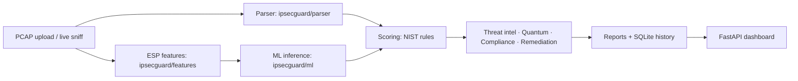

# IPsecGuard AI

IPsecGuard AI is a hackathon proof-of-concept that ingests IPsec VPN packet captures and produces a risk score, NIST sub-scores, a threat matrix, and executive + technical reports — **without decrypting payloads**.

## Observed vs Inferred thesis

- **Observed**: read directly from plaintext IKE fields (`IKE_SA_INIT` for IKEv2, phase 1 SA / aggressive-mode metadata for IKEv1). These we report with certainty.
- **Inferred**: derived from encrypted ESP traffic metadata (packet size, timing, direction) with heuristics or ML, always carrying a confidence value.
- The prototype **never decrypts payloads** — every finding is labelled Observed or Inferred so you always know what is fact and what is inference.

## Architecture



## Quickstart

Models ship pre-trained, so you can run the dashboard directly:

```bash
pip install -e .
python -m uvicorn ipsecguard.api.main:app --host 127.0.0.1 --port 8000 --reload
# open http://localhost:8000, then Analyze Protocol on a preset sample or Upload PCAP
```

To regenerate the dataset and retrain from scratch instead: `make synth-data && make train`.
Run the test suite with `make test` (or `pytest`).

## What the prototype does

**Core analysis**
- Observed IKE parsing: cipher suite, DH group, IKE version, and tunnel-vs-transport mode read from the plaintext handshake.
- Inferred traffic classification (XGBoost) on encrypted ESP metadata, with a confidence score and **SHAP** feature explainability.
- Anomaly detection (Isolation Forest) for sessions that behave unusually even when settings look fine.
- Strict parser/ML separation, so ESP cipher, mode, and auth method are never mislabelled as Observed.

**Scoring & intelligence**
- Risk score with five **NIST SP 800-77** sub-scores (crypto strength, key management, forward secrecy, replay protection, metadata exposure).
- **MITRE ATT&CK / CVE** threat-intel mapping for each finding.
- Post-quantum (PQC) resilience assessment with harvest-now-decrypt-later (HNDL) risk.
- Compliance matrix and a remediation / hardening playbook with concrete fixes.
- 3×3 threat matrix by likelihood and impact.

**Platform**
- Downgrade-attack demo scenarios (strong config vs weakened config, watch the score collapse).
- Live packet sniffer and a P2P VPN lab, plus PCAP diff-compare and benchmarks.
- Frame-level packet dissector (IKE plaintext vs ESP encrypted).
- Executive + technical reports (HTML, with PDF via WeasyPrint), SQLite scan history, and JSON/CSV export.
- Single-page FastAPI dashboard.

## Hackathon-scoped testbed

- `testbed/docker-compose.yml` scaffolds two strongSwan containers on a bridge network.
- `testbed/sweep.py` runs the config sweep and writes a capture manifest for privileged testbed runs.
- The prototype also runs entirely from `scripts/synth_data.py` and the shipped samples, so it works without Docker, tshark, or privileged CI.

## Future work / out of scope

- SMS / email alerting and SIEM integration.
- Real strongSwan Docker sweep execution in CI.
- Larger real-world capture datasets and full production deployment.
- IPv6 coverage beyond the documented testbed scaffold.
